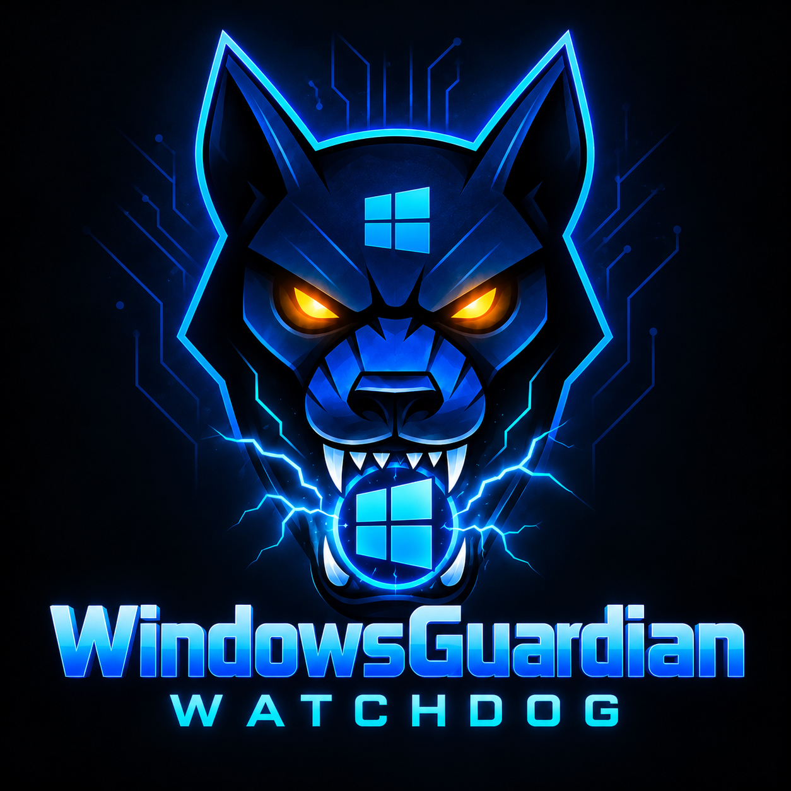

# Windows Guardian Watchdog

<p align="center">
  
</p>

<p align="center">
  <strong>Native Windows protection with a security-first, local-only design.</strong>
</p>

A comprehensive Windows-native security monitoring and threat detection application — the Windows Guardian in **CERBERUS (`CerberusGuardian-SecuritySuite`)**, alongside [MacGuardianWatchdog](https://github.com/abelxmendoza/MacGuardianWatchdog) and [LinuxGuardianWatchdog](https://github.com/abelxmendoza/LinuxGuardianWatchdog). Built with WinUI 3 for a modern, native Windows experience.

The wolf mark is used consistently by the executable, Windows taskbar, Desktop shortcut, Start menu entry, navigation shell, and application pages. The full wordmark above is the canonical project artwork.

## Features

### 🔐 Security Monitoring
- **Real-time Process Monitoring**: Track all running processes, detect suspicious activity
- **Network Connection Analysis**: Monitor network connections for anomalies
- **System Integrity Checks**: Verify Windows Defender, Firewall, and UAC status
- **Threat Detection**: Blue Team threat hunting capabilities
- **File Integrity Monitoring**: Track file changes, detect unauthorized modifications
- **Security Auditing**: Comprehensive security assessment with scoring
- **Automated Remediation**: Fix common security issues automatically

### 🎯 Core Capabilities

1. **Security Monitor**
   - Real-time process monitoring
   - Suspicious process detection
   - Memory and CPU usage tracking
   - System security status checks

2. **File Integrity Monitor**
   - Baseline creation and comparison
   - File change detection (modified, deleted, new files)
   - SHA-256 hash verification
   - Metadata change tracking

3. **Threat Detection (Blue Team)**
   - Process-based threat hunting
   - Network threat analysis
   - Configuration security checks
   - Registry persistence detection
   - Digital signature verification

4. **Security Audit**
   - System security assessment
   - User account analysis
   - Network security evaluation
   - Update status checking
   - Encryption status verification
   - Security scoring (0-100)

5. **Remediation Engine**
   - Enable Windows Defender
   - Enable Firewall
   - Enable UAC
   - Kill suspicious processes
   - Quarantine files
   - Remove startup entries
   - Dry-run mode for safety

6. **Windows Service**
   - Background monitoring
   - Automatic threat detection
   - Event log integration
   - Scheduled threat hunts

### Ported from the Mac and Linux apps

7. **Notices and change watch** (Linux `defenses.py` + `tripwires.py`, Mac/Linux incident timeline)
   - Every five minutes while the app is open, reads the settings an intruder changes first: Windows Firewall,
     Defender real-time protection and policy, UAC, the Administrators group, local accounts, Run/RunOnce keys,
     Startup folders, Winlogon Shell/Userinit, debugger (IFEO) hijacks, the hosts file, and the Sticky Keys /
     Utility Manager swap
   - The first look records what is normal; after that each change becomes a notice with plain advice and its
     MITRE ATT&CK technique. A defense is only an alarm when it was on and went off
   - Repeats fold into one notice; unread notices show as a badge on the Notices menu item

8. **Quarantine** (Mac `quarantine_manager.sh`, Linux `quarantine.py`)
   - Reversible: the file is copied, hash-checked, renamed so it can't run, made read-only, then removed
   - Restore puts it back where it came from, never over a file that is there now; delete for good is separate
   - Windows' own files are refused. "Fix a problem" now quarantines through the same vault

9. **Who can connect** (Linux `exposure_inventory.py`)
   - Every listening TCP/UDP port with its owning program, and whether only this PC, one network, or any network
     can reach it, with advice for risky services (Remote Desktop, SMB, WinRM, databases, VNC, Telnet…)
   - Detection only; nothing is closed

10. **App health** (Mac Self-Check, Linux `self_check.py`)
    - The app's own files against the hashes recorded for this build, app folder permissions, saved settings that
      no longer parse (restorable from a daily backup), the change watch's last run, recent crashes, disk space

11. **Reports** (Mac Reports view)
    - Make a report or weekly summary on demand and reopen earlier ones

## Architecture

```
WindowsGuardianWatchdog/
├── Core/
│   ├── SecurityMonitor.cs          # Real-time security monitoring
│   ├── FileIntegrityMonitor.cs     # File integrity tracking
│   ├── BlueTeamDetector.cs         # Threat detection & hunting
│   ├── SecurityAudit.cs            # Security assessment
│   └── RemediationEngine.cs        # Automated remediation
├── Services/
│   └── WindowsGuardianService.cs   # Windows Service for background monitoring
├── Views/
│   ├── DashboardView.xaml          # Main dashboard
│   ├── SecurityMonitorView.xaml    # Process monitoring UI
│   ├── FileIntegrityView.xaml      # File monitoring UI
│   ├── ThreatDetectionView.xaml    # Threat hunting UI
│   ├── SecurityAuditView.xaml      # Security audit UI
│   ├── RemediationView.xaml        # Remediation center
│   └── AlertsView.xaml             # Security alerts
├── App.xaml                         # WinUI 3 application
├── MainWindow.xaml                  # Main window with navigation
└── WindowsServiceInstaller.cs      # Service installer
```

## Requirements

- Windows 11, or Windows 10 version 2004 (build 19041) or later with update KB5013942 or newer (needed to run the app as administrator)
- .NET 8.0 or later
- Administrator privileges (for service installation and some features)

## Building the Project

```bash
# Restore packages
dotnet restore

# Build the project
dotnet build

# Run the application
dotnet run
```

## Creating a download

Users should receive one signed MSIX, not a zip of loose files. Windows checks that signature and shows the publisher name before installation.

```powershell
$env:WG_SIGNING_PASSWORD = "<password>"
.\Publish-Release.ps1 -CertificatePath C:\secure\codesign.pfx -DownloadBaseUrl "https://github.com/<owner>/<repo>/releases/download/v1.0.0"
```

The files are written to `dist\release`. The certificate has to come from a public certificate authority or Microsoft Trusted Signing. A self-signed certificate does not make Windows or Microsoft trust the app.

See [DISTRIBUTION.md](DISTRIBUTION.md) for the checksum check, GitHub Release secrets, and Microsoft Store submission.

## Installation

### As Desktop Application

1. Build the project: `dotnet build -c Release`
2. Run the executable from `bin/Release/net8.0-windows10.0.19041.0/`

### As Windows Service

#### Using PowerShell Script

```powershell
# Install the service (run as Administrator)
.\InstallService.ps1

# Uninstall the service
.\InstallService.ps1 -Uninstall
```

#### Using InstallUtil

```bash
# Install
InstallUtil.exe WindowsGuardianWatchdog.exe

# Uninstall
InstallUtil.exe /u WindowsGuardianWatchdog.exe
```

#### Service Management

```powershell
# Start service
Start-Service -Name "WindowsGuardianWatchdog"

# Stop service
Stop-Service -Name "WindowsGuardianWatchdog"

# Check status
Get-Service -Name "WindowsGuardianWatchdog"

# View logs
Get-EventLog -LogName Application -Source "WindowsGuardianWatchdog" -Newest 50
```

## Usage

### Desktop Application

1. **Launch the application** - The dashboard shows system status at a glance
2. **Start Monitoring** - Click "Start Monitoring" to begin real-time security monitoring
3. **Run Security Audit** - Perform a comprehensive security assessment
4. **Threat Hunt** - Actively search for threats on your system
5. **File Integrity** - Add paths to monitor and create baselines
6. **Remediation** - Fix security issues automatically (with dry-run mode)

### Windows Service

The service runs in the background and:
- Monitors processes every 30 seconds
- Checks file integrity every 5 minutes
- Performs threat hunts every hour
- Logs all events to Windows Event Log

## CERBERUS Security Suite Comparison

| Feature | Windows Guardian | LinuxGuardian | MacGuardian |
|---------|-----------------|---------------|-------------|
| Process Monitoring | ✅ | ✅ | ✅ |
| File Integrity (SHA-256) | ✅ | ✅ | ✅ |
| Threat Detection / Sensors | ✅ | ✅ | ✅ |
| Security Audit & Hardening | ✅ | ✅ | ✅ |
| Controlled Remediation (Dry-Run) | ✅ | ✅ | ✅ |
| Reversible Quarantine | ✅ | ✅ | ✅ |
| Network Exposure Inventory | ✅ | ✅ | ✅ |
| App Self-Check | ✅ | ✅ | ✅ |
| Background Scheduling | Windows Service | `systemd --user` | `launchd` |
| Native UI | WinUI 3 | GTK4 + libadwaita | SwiftUI |

## Project Structure

- **Core Modules**: Security monitoring, file integrity, threat detection, auditing, remediation
- **Services**: Windows Service for background operation
- **Views**: WinUI 3 native interface with navigation
- **Installation**: Service installer and PowerShell scripts

## Security Considerations

- **Dry-Run Mode**: All remediation actions default to dry-run for safety
- **Quarantine System**: Files are moved to quarantine, not deleted
- **Event Logging**: All security events are logged to Windows Event Log
- **Administrator Rights**: Required for service installation and some security checks

## Troubleshooting

### App closes right away or won't open from the taskbar
Approve the administrator prompt; the app needs it. If the window still never appears, the reason is written to `%ProgramData%\WindowsGuardianWatchdog\crash.log`.

### Permission Issues
Some operations require administrator privileges. The application will prompt when needed.

### Service Not Starting
- Ensure you have administrator rights
- Check Windows Event Log for errors
- Verify .NET 8.0 runtime is installed

### Monitoring Not Working
- Check if Windows Defender is blocking the application
- Verify file permissions for monitored paths
- Review Event Log for detailed error messages

## Contributing

Contributions welcome! Areas for improvement:
- Additional threat detection rules
- More remediation actions
- Enhanced reporting
- Cloud integration options
- Multi-device management

## License

This project is licensed under the MIT License.

## Acknowledgments

Inspired by [MacGuardianWatchdog](https://github.com/abelxmendoza/MacGuardianWatchdog) - bringing enterprise-grade security monitoring to Windows.

---

**Stay secure! 🔐**

_Windows Guardian Watchdog - Enterprise-Grade Security for Windows_
